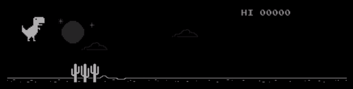

# 🦖 Dino Bot

<p align="center">
  
</p>

> An intelligent, autonomous runner bot for the Chrome T-Rex game powered by custom jump-arc physics planning and Playwright automation.

---

## 📋 Table of Contents

- [Overview](#-overview)
- [Key Features](#-key-features)
- [How It Works](#-how-it-works)
- [Prerequisites](#-prerequisites)
- [Step-by-Step Setup Guide](#-step-by-step-setup-guide)
  - [Step 1: Install Python](#step-1-install-python)
  - [Step 2: Get the Code](#step-2-get-the-code)
  - [Step 3: Create a Virtual Environment (Recommended)](#step-3-create-a-virtual-environment-recommended)
  - [Step 4: Install Dependencies](#step-4-install-dependencies)
  - [Step 5: Install Playwright Browsers](#step-5-install-playwright-browsers)
- [How to Run Dino Bot](#-how-to-run-dino-bot)
  - [Operating Modes](#operating-modes)
  - [Quick Commands](#quick-commands)
- [Configuration & Environment Variables](#-configuration--environment-variables)
- [Troubleshooting](#-troubleshooting)

---

## 🦅 Overview

**Dino Bot** is a high-performance Python script designed to play the famous Chrome T-Rex runner game at maximum efficiency. Instead of relying on crude pixel-matching or simple threshold delays, **Dino Bot** injects a lightweight, frame-by-frame physics engine directly into the game's JavaScript runtime environment.

Whether you're testing automation on public mirrors or taking your own browser offline to beat the native Chrome easter egg, Dino Bot handles jump planning, obstacle categorization, speed-dropping, and ducking dynamically.

---

## ✨ Key Features

- **Jump-Arc Planner Engine:** Simulates the T-Rex’s velocity, gravity, and bounding box hitboxes up to 220 frames into the future to calculate guaranteed safe takeoff windows.
- **Adaptive Speed Dropping:** Forcefully pulls the T-Rex back down as soon as an obstacle is cleared, allowing faster re-jumps for tightly spaced cacti and low birds.
- **Dynamic Obstacle Classification:**
  - **Cacti:** Precise jump planning.
  - **Pterodactyls:** Automatically ducks mid-height birds and runs safely under high-height birds.
- **3 Flexible Operational Modes:**
  1. **Automated Chromium (Playwright):** Zero-configuration, clean browser instance.
  2. **Regular Session (CDP Attached):** Attaches directly to your installed Chrome, Edge, or Brave browser.
  3. **Native Offline Mode:** Forces a isolated tab offline to play Chrome’s built-in `chrome://dino` game.

---

## 🧠 How It Works

1. **Browser Driver:** Uses [Playwright](https://playwright.dev/) to open or connect to a Chromium-based browser session.
2. **Bot Injection (`BOT_JS`):** Injects a high-speed JavaScript engine using `requestAnimationFrame`.
3. **Real-time Collision Engine:**
   - Reads game state properties (`Runner.instance_` or `Runner.getInstance()`).
   - Simulates player velocity ($v_0$), gravity ($g$), and obstacle movement ($speed$) every frame.
   - Evaluates single and multi-jump combinations (up to 3 chained jumps ahead) to select the optimal jump takeoff point.

---

## 🛠 Prerequisites

Before installing, ensure your system has:
- **Python:** Version `3.8` or higher installed on your system.
- **Supported Browsers (Optional for Mode 2/3):** Google Chrome, Microsoft Edge, or Brave installed locally.

---

## 🚀 Step-by-Step Setup Guide

Follow these simple steps to get Dino Bot running on **Windows**, **macOS**, or **Linux**.

### Step 1: Install Python

1. Download Python from the official site: [python.org/downloads](https://www.python.org/downloads/).
2. **IMPORTANT (Windows Users):** During installation, make sure to check the box that says **"Add Python to PATH"**.

Verify Python is installed by running this command in your Terminal (macOS/Linux) or Command Prompt / PowerShell (Windows):

```bash
python --version
# or on macOS/Linux:
python3 --version
```

---

### Step 2: Get the Code

Clone this repository or download the project files into a folder on your computer:

```bash
git clone https://github.com/ichidera/Dino-bot.git
cd dino-bot
```

*(If you downloaded a `.zip` file, extract it and open your terminal inside that folder).*

---

### Step 3: Create a Virtual Environment (Recommended)

A virtual environment keeps project dependencies isolated and organized.

- **Windows:**
  ```cmd
  python -m venv venv
  venv\Scripts\activate
  ```

- **macOS / Linux:**
  ```bash
  python3 -m venv venv
  source venv/bin/activate
  ```

---

### Step 4: Install Dependencies

Install the required Python packages specified in `requirements.txt`:

```bash
pip install -r requirements.txt
```

---

### Step 5: Install Playwright Browsers

Playwright requires a headless/headed Chromium binary to run automated browser sessions. Install it by running:

```bash
playwright install chromium
```

---

## 🎮 How to Run Dino Bot

### Operating Modes

When you launch the script without arguments, Dino Bot displays an interactive menu to choose your mode:

| Mode | Name | Description |
| :---: | :--- | :--- |
| **1** | **Chromium** | Launches Playwright's bundled Chromium browser and plays on `trex-runner.com`. Best for plug-and-play. |
| **2** | **Regular Session** | Connects to your installed desktop browser (Chrome/Edge/Brave) via DevTools port (`9222`) using a dedicated profile folder (`~/.trex_bot_profile`). |
| **3** | **Offline** | Emulates network disconnect on a single tab to load Chrome's internal dino game on any standard error page. |

---

### Quick Commands

#### 1. Interactive Menu
Launch the interactive prompt to choose your mode:
```bash
python trex_bot.py
```

#### 2. Run Direct Mode via Command Line Flags

- **Launch Playwright Chromium (Mode 1):**
  ```bash
  python trex_bot.py --mode 1
  ```

- **Connect to Installed Desktop Browser (Mode 2):**
  ```bash
  python trex_bot.py --mode 2
  ```

- **Run Native Offline Chrome Dino (Mode 3 in standalone Chromium):**
  ```bash
  python trex_bot.py --mode 3 --offline-in chromium
  ```

- **Run Native Offline Chrome Dino (Mode 3 in your regular Chrome):**
  ```bash
  python trex_bot.py --mode 3 --offline-in regular
  ```

To stop the bot at any time, press **`Ctrl + C`** in your terminal window.

---

## ⚙️ Configuration & Environment Variables

You can customize the bot's browser executable path, profile storage location, and debugging ports using environment variables:

| Variable | Default Value | Description |
| :--- | :--- | :--- |
| `TREX_CDP_PORT` | `9222` | The Remote Debugging Port used for connecting to local Chrome sessions. |
| `TREX_PROFILE` | `~/.trex_bot_profile` | Directory path where session profiles, cache, and extensions are stored. |
| `TREX_BROWSER` | Auto-detected | Custom file path to your browser executable (`chrome.exe`, `msedge.exe`, etc.). |

### Example Usage with Environment Variables:

**Linux / macOS:**
```bash
TREX_CDP_PORT=9333 TREX_BROWSER="/usr/bin/google-chrome" python trex_bot.py --mode 2
```

**Windows (PowerShell):**
```powershell
$env:TREX_CDP_PORT="9333"
python trex_bot.py --mode 2
```

---

## 🔍 Troubleshooting

### 1. `Command 'playwright' not found`
Ensure you have activated your virtual environment and ran `pip install -r requirements.txt`. If you still face issues, run:
```bash
python -m playwright install chromium
```

### 2. Browser Debugging Port Error in Mode 2
If Chrome 136 or newer ignores the debugging port on your default browser profile, Dino Bot automatically isolates the run into `~/.trex_bot_profile`. Make sure all other Chrome windows using that profile directory are closed if a port collision occurs.

### 3. Spacebar / Game Not Starting
If the bot connects but the dino does not move, click inside the active browser tab once or press the **`Spacebar`** key manually on your keyboard to focus and start the game.

---

## 📄 License

This project is open-source and available under the [MIT License](LICENSE).